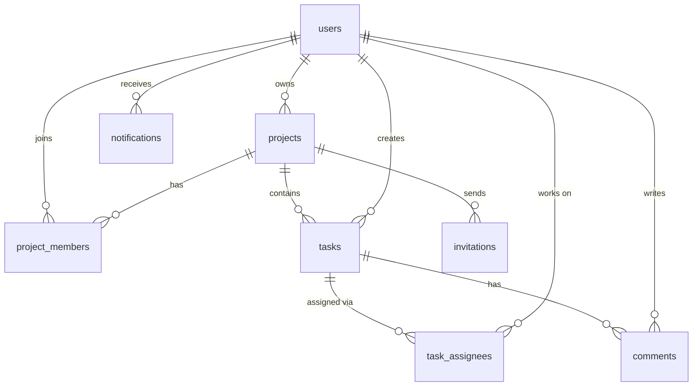

# TaskFlow

A modern task manager for students, freelancers and small teams. Projects, tasks, a drag-and-drop Kanban board, roles and permissions, invitations, comments and in-app notifications.

**Stack:** React 19 + Vite + Tailwind CSS 4 + React Router + Axios · Laravel 13 (REST API) + Laravel Sanctum + MySQL

This project is built to run on your own machine (localhost). It is not configured for any hosting provider.

## Features

- Cookie-based authentication (Laravel Sanctum SPA mode): register, login, logout, profile, change password, forgot/reset password. No tokens are stored in the browser.
- Dashboard with real statistics: projects, tasks, completed, in progress, overdue, upcoming deadlines, recent projects and tasks, a 7-day completion chart and recent notifications.
- Projects: create, edit, archive/restore, delete, search, filter by status and role, progress bar, members.
- Tasks: title, description, status, priority (Low/Medium/High/Urgent), due date, creator, multiple assignees, comments. Search, filter (status, priority, assignee, due date), sort, pagination.
- Kanban board: four columns, drag and drop, saved through the API with optimistic updates that roll back on error, task detail drawer, horizontal scrolling on phones.
- Roles enforced on the backend with Laravel Policies: Owner, Manager, Member.
- Email invitations with expiry (7 days). The invite link is shown to the owner, and the email is written to the Laravel log, so no mail provider is needed.
- Notifications: task assigned, new comment, deadline approaching. Unread badge, mark as read, mark all as read.
- Light mode by default, optional dark mode, responsive sidebar/bottom navigation, toasts, confirmation dialogs, loading/empty/error states, keyboard-accessible dialogs.

## Requirements

- PHP 8.3+ with the extensions `pdo_mysql`, `mbstring`, `openssl`, `tokenizer`, `xml`, `ctype`, `json` (and `pdo_sqlite` to run the tests)
- Composer 2
- Node.js 20+ and npm
- MySQL 8 (or MariaDB 10.6+)

## Quick start

### 1. Database

```sql
CREATE DATABASE taskflow CHARACTER SET utf8mb4 COLLATE utf8mb4_unicode_ci;
```

### 2. Backend (Laravel API on http://localhost:8000)

```bash
cd backend
composer install
cp .env.example .env          # Windows (cmd): copy .env.example .env
php artisan key:generate
# edit .env: set DB_USERNAME / DB_PASSWORD for your local MySQL
php artisan migrate --seed
php artisan serve
```

### 3. Frontend (React app on http://localhost:5173)

```bash
cd frontend
npm install
npm run dev
```

Open **http://localhost:5173**. Always use `localhost` (not `127.0.0.1`), because session cookies are tied to the host name.

Demo accounts created by the seeder (password for all: `password`):

| Email | Notes |
|---|---|
| demo@taskflow.test | Owner of "Website Redesign", member of "Thesis Research" |
| sara@taskflow.test | Manager in "Website Redesign", owner of "Thesis Research" |
| omar@taskflow.test | Member in "Website Redesign" |

### How the frontend talks to the API

The Vite dev server forwards `/api` and `/sanctum` to Laravel (see `frontend/vite.config.js`). The browser therefore only talks to `localhost:5173`, which keeps Sanctum's session and CSRF cookies first-party and avoids CORS problems. If your API runs on another port, set `VITE_BACKEND_URL` in `frontend/.env`.

### Optional: deadline reminders

Reminders for tasks due today or tomorrow are sent by a scheduled command. While developing, run this in a third terminal:

```bash
cd backend
php artisan schedule:work
```

Or trigger it once: `php artisan taskflow:deadline-reminders`.

### Tests

```bash
cd backend
php artisan test
```

The tests use an in-memory SQLite database and cover authentication, validation, role permissions, task operations, comments, invitations and notifications.

## Roles and permissions

| Action | Owner | Manager | Member |
|---|:-:|:-:|:-:|
| View project, tasks, members | ✓ | ✓ | ✓ |
| Create tasks | ✓ | ✓ | ✓ |
| Edit / move tasks | all | all | own or assigned |
| Delete tasks | all | all | own |
| Assign tasks to people | ✓ | ✓ | – |
| Comment on tasks | ✓ | ✓ | ✓ |
| Edit project name and description | ✓ | ✓ | – |
| Invite, remove members, change roles | ✓ | – | – |
| Archive / delete project | ✓ | – | – |
| Leave project | – | ✓ | ✓ |

Every rule lives in `backend/app/Policies`. The frontend only hides buttons, and the API still answers `403` if someone calls it directly.

## Database



- `project_members` holds the role per project (`owner`, `manager`, `member`) with a unique (`project_id`, `user_id`).
- `task_assignees` is the many-to-many pivot between tasks and users, unique on (`task_id`, `user_id`).
- Deleting a project cascades to its members, tasks, comments and invitations. Deleting a user keeps their tasks and comments (`creator_id` / `user_id` become `NULL`).
- Invitation tokens are stored as SHA-256 hashes.
- Notifications use Laravel's standard `notifications` table. Password reset tokens use `password_reset_tokens`.
- Everything is created by migrations in `backend/database/migrations`.

## API overview

All routes are under `/api/v1`. Private routes need the session cookie.

| Area | Endpoints |
|---|---|
| Auth | `POST register`, `POST login`, `POST logout`, `GET user`, `PUT profile`, `PUT profile/password`, `POST forgot-password`, `POST reset-password` |
| Dashboard | `GET dashboard` |
| Projects | `GET/POST projects`, `GET/PUT/DELETE projects/{id}`, `POST projects/{id}/archive`, `POST projects/{id}/unarchive` |
| Members | `GET projects/{id}/members`, `PUT/DELETE projects/{id}/members/{user}` |
| Invitations | `GET/POST projects/{id}/invitations`, `DELETE invitations/{id}`, `GET invitations/{token}`, `POST invitations/{token}/accept` |
| Tasks | `GET tasks` (all my projects), `GET/POST projects/{id}/tasks`, `GET/PUT/DELETE tasks/{id}`, `PATCH tasks/{id}/status` |
| Comments | `GET/POST tasks/{id}/comments`, `DELETE comments/{id}` |
| Notifications | `GET notifications`, `GET notifications/unread-count`, `POST notifications/{id}/read`, `POST notifications/read-all` |
| Health | `GET health` |

Task list query parameters: `q`, `status`, `priority`, `assignee` (`me`, `unassigned` or a user id), `due` (`overdue`, `today`, `week`, `none`), `sort`, `direction`, `page`, `per_page`.

## Project structure

```
taskflow/
├── backend/                  Laravel API
│   ├── app/Http/Controllers/Api/V1   focused controllers
│   ├── app/Http/Requests             validation
│   ├── app/Http/Resources            JSON shapes
│   ├── app/Policies                  authorization rules
│   ├── app/Models, app/Notifications, app/Console/Commands
│   ├── database/migrations, database/seeders
│   ├── routes/api.php
│   └── tests/Feature
└── frontend/                 React app
    └── src
        ├── api/              all HTTP requests (no requests inside components)
        ├── components/       ui, layout, tasks, kanban, project, charts
        ├── context/          Auth, Theme, Toast
        ├── hooks/, pages/, routes/, utils/
```

## Sending real emails (optional)

By default `MAIL_MAILER=log` writes emails (password reset, invitations) to `backend/storage/logs/laravel.log`. To use an SMTP provider, set `MAIL_MAILER=smtp` and the `MAIL_HOST`, `MAIL_PORT`, `MAIL_USERNAME`, `MAIL_PASSWORD` and `MAIL_FROM_ADDRESS` values in `backend/.env` from your provider's dashboard.

## Troubleshooting

- **419 / "CSRF token mismatch" or being logged out immediately:** open the app on `http://localhost:5173` (not `127.0.0.1`), keep `SANCTUM_STATEFUL_DOMAINS=localhost:5173` in `.env`, then run `php artisan config:clear`.
- **"Cannot reach the server":** start `php artisan serve` on port 8000.
- **SQLSTATE connection refused / access denied:** check `DB_*` values in `backend/.env` and that MySQL is running and the `taskflow` database exists.
- **Tests: "could not find driver":** enable the `pdo_sqlite` PHP extension.
- **Reset the demo data:** `php artisan migrate:fresh --seed`.

## Security notes

- Credentials and secrets live in `.env` files, which are git-ignored. Only `.env.example` files are committed.
- Passwords are hashed, login and password-reset endpoints are rate limited, the forgot-password response never reveals whether an email exists, and invitations are bound to the invited email address.
- The demo password (`password`) is for local seed data only.
